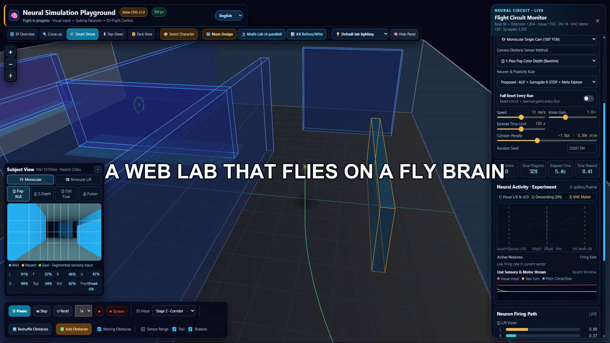
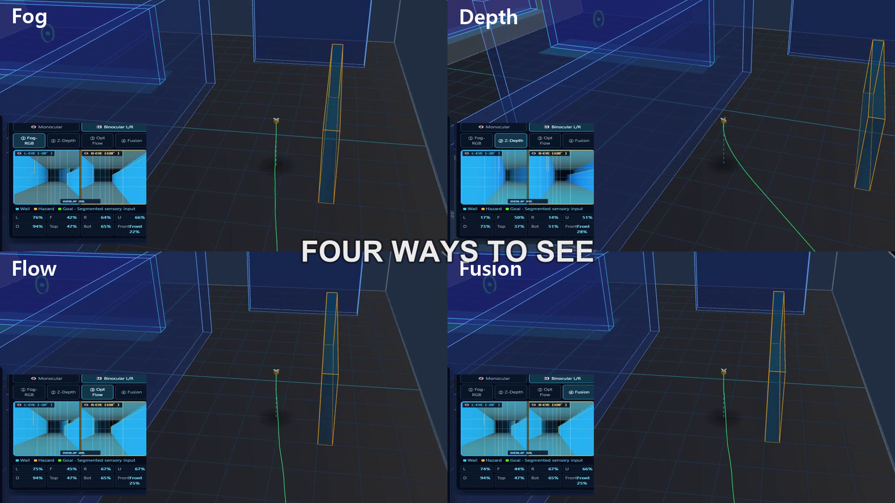
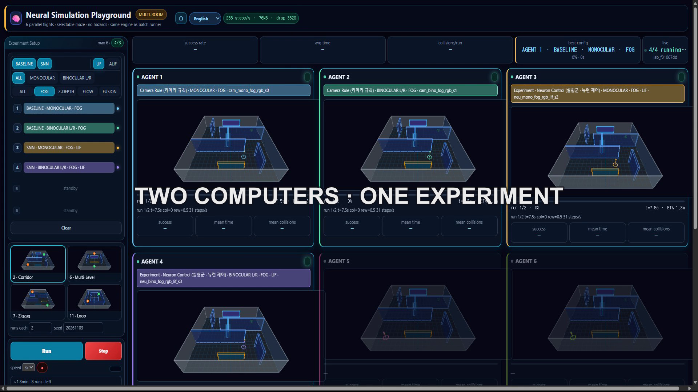

# NSP3D — Neural Simulation Playground 3D

English | [한국어](README_KO.md)

**A 3D Flight Simulation Playground Using Fruit Fly Neural Circuits**

The camera captures the environment and sends visual information to neurons. Neural responses are then used to control flight direction.

**Meta Global AI Developer Hackathon 2026 Project**

<p align="center">
  <a href="https://jiyoung-ai-lab.github.io/nsp3d-hackathon/"></a>
</p>

<p align="center">
  
  
  
  
  
  
  
  
</p>

## Project Overview

Explore how neural circuits translate visual input into flight behavior in a 3D environment.

Camera → Neuron → Behavior

NSP3D is a browser-based simulator for experimenting with flight control in a 3D virtual environment using fruit fly neural connectivity data (Male CNS v1.0). Built with Three.js, it connects the entire process—from camera input to neural circuit responses and behavioral control—into a single workflow.

Users can observe how a simulated flying agent perceives obstacles in a 3D maze and determines its direction through neural circuits.

* **Neural Circuit:** A partial connectome graph based on Male CNS, consisting of 1,854 neurons and 3,305 directed connections.
* **Flight Environment:** A 1m × 1m × 0.20m chamber with 10 maze layouts.
* **Visual Input:** Monocular and binocular cameras, with Fog, Depth, Optical Flow, and Sensor Fusion.
* **Neural Models:** LIF by default, with an optional ALIF surrogate model.
* **Experiments:** Browser-based batch execution and result comparison.

Unlike conventional deep learning models, not all neurons are continuously active. During ALIF flight tests, approximately 2–3% of neurons exceeded their firing thresholds. This figure is based on the AX main test conducted on November 1, 2026.

## Key Questions and Current Results

### 1. Can a virtual laboratory run in a browser?

Yes.

The simulator and batch experiments run directly in a browser. More than 1,500 flights have been tested cumulatively. Results under identical conditions were also compared between a laptop and a desktop PC.

A separate main LIF/ALIF test consisted of 864 flights. These results should be interpreted separately from the cumulative experiment count.

### 2. Can a neural controller fly better?

It depends on the environment and test conditions.

In challenging corridor-style and zigzag mazes, the neural controller showed better results than the camera-based rule controller. In simpler mazes, however, the camera controller also achieved a 98% success rate.

The 864-flight LIF/ALIF main test produced the following results:

| Model | Flights | Success Rate | Average Collisions | Average Time |
| ----- | ------: | -----------: | -----------------: | -----------: |
| ALIF  |     432 |        91.9% |               1.66 |     29.4 sec |
| LIF   |     432 |        86.1% |               2.03 |     33.9 sec |

Under these test conditions, ALIF showed a 5.8 percentage-point higher success rate than LIF, with fewer average collisions and a shorter average completion time. These results do not imply that the same performance difference will occur in every environment.

The results are descriptive statistics. No statistical significance testing was performed.

### 3. Can neurons learn autonomously?

This is still under implementation and validation.

A 3-Factor R-STDP learning pathway is connected, but all currently reported batch experiments were conducted with learning disabled. Therefore, the reported results do not demonstrate learning effects.

## Model and Biological Scope

**The neural circuit data are based on fruit fly (Male CNS v1.0) connectivity data.**

* **Connectome:** A partial connectome selected and assembled from anatomical connectivity data in Male CNS v1.0.
* **Neuron Models:** LIF and an optional ALIF surrogate model.
* **Visual Processing:** Virtual binocular cameras inspired by the visual structure of fruit flies.
* **Behavioral Control:** Simulation algorithms informed by research on insect flight and obstacle avoidance.

The binocular vision system uses an overlap-processing region within ±25° of the forward direction. Its ray-mapping geometry is based on a model inspired by fruit fly visual structures.

**Important:** Anatomical connectivity data do not mean that the actual neural responses or behaviors of a living organism are being reproduced. Excitatory and inhibitory relationships are not determined solely from synaptic connectivity. This project is a platform for experimenting with flight-control algorithms, not a study that validates biological neural responses.

The 3D character uses a striped flying-agent model. Its visual appearance is separate from the biological origin of the neural circuit data.

## Technical Architecture

| Component           | Description                                                   |
| ------------------- | ------------------------------------------------------------- |
| 3D Engine           | Three.js r160                                                 |
| Simulation          | JavaScript-based flight and physics engine                    |
| Neural Circuit      | Partial connectome-based SNN using Male CNS v1.0              |
| Neuron Models       | LIF, optional ALIF surrogate plugin                           |
| Visual Input        | Fog, Depth, Optical Flow, Sensor Fusion                       |
| Flight Control      | Neural circuit-based control and camera-based rule controller |
| Experiment Analysis | Python batch harness and local statistical analysis           |
| AI Tools            | Meta Muse Spark and Muse Code                                 |

### Visual System

Two camera configurations are supported.

* **Monocular:** 320 × 180, 100° horizontal field of view.
* **Binocular:** 216 × 160 × 2, 3.6 mm baseline, 28° outward cant angle.

Visual information is divided into an 8 × 4 grid. Threat levels are calculated based on obstacle occupancy. Fog, Depth, and Optical Flow information can be processed independently or combined.

The visual processing pipeline separates the RGB-based color/region classification path from the sensor feature calculation path.

* **RGB Color and Region Processing:** Classifies screen colors and regions, and is used for routing tasks such as distinguishing floor and background areas.
* **Sensor Feature Processing:** Fog, Optical Flow, and Depth information are derived through separate processing paths.
* **Sensor Fusion:** Combines sensor features for use as visual input. Depth information can be excluded from the fusion path when its reliability or processing stability is insufficient.

The final adopted `fu13` configuration combines Fog and Optical Flow information while excluding Depth.

RGB color information itself does not directly measure distance or motion. Color/region classification and sensor feature calculation serve different purposes.

Baseline threat calculation:

`threat = (occ - 0.025) * 1.5`

For details on sensor processing methods and experiment settings, refer to `docs/CHANGELOG.md` and the related design documents.

### Flight Controllers

| Controller | Characteristics                                         | Learning Status                   |
| ---------- | ------------------------------------------------------- | --------------------------------- |
| LIF        | Custom spiking neural network with differential readout | Learning OFF in batch experiments |
| ALIF       | LIF with adaptive firing thresholds                     | Learning OFF in batch experiments |
| Camera     | Rule-based control using camera signals                 | No learning                       |

R-STDP is a pathway intended for future learning experiments. It is not reflected in the currently reported performance results.

Differences are also observed between LIF and ALIF in their firing responses to sustained visual stimulation. LIF may accumulate firing activity or reach saturation in left-right firing responses under sustained stimulation. ALIF adjusts its response to sustained stimulation through adaptive firing thresholds.

These differences are technical interpretations intended to explain the operating characteristics of the two models. Whether neuronal saturation or the loss of left-right firing-rate differences directly causes the performance gap requires further investigation using neuron-level firing records and analysis. These interpretations are not presented as established biological mechanisms.

Firing rates measured under identical input conditions (1,854 neurons, averaged over 120 steps):

| Model | Weak Stimulation | Unilateral Threat | Bilateral Threat |
| ----- | ---------------: | ----------------: | ---------------: |
| LIF   |             9.5% |             18.3% |            36.5% |
| ALIF  |               0% |              5.2% |            10.4% |

Under identical input, ALIF activates approximately 28% as many neurons as LIF. Under weak sustained stimulation, ALIF remained silent while LIF showed 9.5% activity. These figures are based on fixed-input probes; actual flight measurements vary depending on the conditions.

## Experimental Environment

Experiments run in the browser. A local batch harness can repeatedly test different configurations and random seeds.

| Tool                      | Function                                               |
| ------------------------- | ------------------------------------------------------ |
| `pages/experiment.html`   | Manual comparison experiments with up to 4 slots       |
| `pages/batch.html`        | Batch experiments with 23 groups                       |
| `pages/multilab.html`     | Public lab for running up to 6 experiments in parallel |
| `pages/path-planner.html` | A* pathfinding tests                                   |
| `pages/maze-editor.html`  | Maze editing                                           |
| `pages/vision-lab.html`   | Visual input testing                                   |

Experiment settings are managed in `experiments/configs.json`. Results can be saved to local IndexedDB or exported as files.

### Runtime Performance

* Headless SwiftShader: approximately 90–140 FPS (12-second test)
* GPU visual capture: approximately 25–60 FPS (8-frame measurement)
* Batch execution: up to 4 simultaneous slots
* Experiment conditions: 1–200 repetitions using identical settings and seeds

Performance varies depending on the browser, hardware, and experiment conditions.

### Tests

```bash
npm test

# Camera pipeline verification
node tests/verify-camera-pipeline.mjs

# Flight neural circuit verification
node tests/verify-flight-circuit.mjs

# Browser regression tests (Playwright)
node tests/verify.browser.mjs
```

Current unit test results: 176 PASS, 0 FAIL, 9 SKIPPED.

## Experimental Results and Limitations

The following limitations have also been identified.

* **Limited Spatial Memory:** The current controller is reactive. It fails in most S-shaped mazes and environments where the goal is obscured.

* **Binocular Vision Bias:** The binocular configuration tends to measure higher forward threat levels than the monocular configuration.

* **Learning Not Yet Validated:** All reported batch experiments were conducted with learning disabled.

* **Sparse Neuron Activation:** Approximately 2–3% of neurons exceed their firing thresholds during ALIF cruise flight.

* **Flight Test Coverage:** Flight tests were conducted across 9 maze types. Before-and-after AX comparisons were performed on 3 of these mazes, which overlapped with earlier tests: mazes 2, 6, and 7.

* **Environmental Validation Scope:** The experimental environments and maze types are limited. Due to development time constraints, systematic comparative analysis under diverse environmental changes was not sufficiently conducted. Further validation is needed across different maze structures, obstacle arrangements, and environmental conditions.

* **Revalidation After Changes:** Current results are valid only for the fixed experimental configuration. If the environment changes—for example, chamber dimensions, agent size, resolution, or parameters—the existing results cannot be directly applied. Changed configurations require separate review and retesting.

* **Depth A/B Comparison:** Depth-in and Depth-out configurations were compared under identical conditions and random seeds across 6 experimental cells: monocular and binocular configurations in mazes 2, 6, and 11. Overall, Depth-out performed better in 4 cells and worse in 2. In particular, Depth-in produced better success rates and fewer collisions in the binocular configuration of maze 2. Therefore, Depth-out cannot be considered universally superior across all environments.

* **Statistical Limitations:** Success rates are descriptive statistics obtained from repeated experiments. No statistical significance testing was performed.

* **Sample Size:** For example, 12 successful flights out of 12 attempts represent the result under that specific condition, not a guarantee of 100% success.

* **Worker Comparison:** The m16 experiment had confounding between sensor conditions and execution machines. It is therefore not used as evidence for comparing sensor performance.

* **Interpretation of Neuron Activity:** Firing saturation in LIF and adaptive responses in ALIF are hypothetical interpretations of the observed model behavior. Further analysis of neuron-level firing records is required before identifying them as direct causes of the performance difference.

## Source Structure

```text
nsp3d/
├── index.html
├── src/
│   ├── sim/
│   ├── vision/
│   ├── nn/
│   └── ui/
├── vendor/connectome/
├── pages/
├── experiments/
├── tests/
├── docs/
└── README.md
```

Main modules:

| File                           | Role                                           |
| ------------------------------ | ---------------------------------------------- |
| `src/vision/camera-vision.js`  | Camera input and visual information processing |
| `src/nn/graph-network.js`      | Connectome-based spiking neural circuit        |
| `src/sim/sim-core.js`          | 3D environment and flight physics              |
| `src/sim/camera-controller.js` | Rule-based baseline controller                 |
| `src/sim/maze-layouts.js`      | Maze geometry                                  |
| `src/ui/app.js`                | Main UI and simulation execution               |

## How to Run

If Python is installed, the project can be launched without a separate build process.

```bash
cd nsp3d

python -m http.server 8000
```

Open the following address in your browser:

`http://localhost:8000/index.html`

## Development and AI Tools

* **Meta Muse Spark:** Natural-language analysis and development support
* **Muse Code:** Code generation and development assistance
* **Baseten:** Muse Spark Open model access and API experiments

The use of AI tools and their roles in the project are documented in:

* `docs/META_AI_USAGE.md`
* `docs/MUSE_SPARK_USAGE.md`

The experiment harness and analysis tools are for local development and are separate from the publicly accessible simulator.

## Meta Technology Usage

The following summarizes the Meta technologies used during the hackathon and their usage.

| Model                      | Channel       | Purpose                                       | Usage                                |
| -------------------------- | ------------- | --------------------------------------------- | ------------------------------------ |
| muse-spark-1.3-contributor | Muse Code CLI | Code generation, debugging, and documentation | 2,758 sessions (across all projects) |
| Meta AI                    | Chat          | Hackathon and recording inquiries             | No logs available (simple inquiries) |
| muse-spark-open-1026       | Baseten API   | Consultation, reviews, and log analysis       | 58 calls · 262,708 tokens            |

* **CLI (2026-10-27 to 2026-11-02, dashboard):** In 2,009M · Out 12.2M · 22.9k requests · 128 tool calls · 93.9% cache hit rate
* **API (2026-10-29 to 2026-11-02, complete `credit_log`):** In 79,351 · Out 183,357 — 33 consultation/review tasks, 18 planning/documentation tasks, 1 narrative task, and 6 probes
* **Workflow:** Meta AI → VSCode terminal → Muse CLI → Baseten API, coding, AX batch execution (local CPU, 0 API tokens), agents, Docker, and AI chat
* **Evidence:** `docs/META_AI_USAGE.md`, `docs/MUSE_SPARK_USAGE.md`, `docs/MUSE_CLI_USAGE.md`, `python/credit_log.jsonl`

## Sources and Licenses

The connectome data is based on Male CNS v1.0 from Janelia Research Campus.

* Data license: CC BY 4.0
* Data sources and processing details: `docs/CITATIONS.md`
* External libraries and assets: `docs/THIRD_PARTY_NOTICES.md`

Existing original project assets are documented separately from external materials.

Sources for the music and connectome visual materials used in the demo video are credited in the relevant documentation and video credits.

## Patent

As of November 2026, the Korean patent is at the **pre-filing preparation stage**.

The technology concerns a 3D flight-control method using binocular visual information processing and a Male CNS-based partial connectome neural circuit.

Public access to or viewing of the project source code does not grant a patent license.

## License

No separate open-source license has been granted at this time.

Until a license is finalized, the project is managed as All rights reserved.

For the purpose of the Meta Global AI Developer Hackathon 2026, the author grants the organizers the rights described in the Official Rules (royalty-free license to use, publish, and modify for event operation and promotion).

## Screenshots




