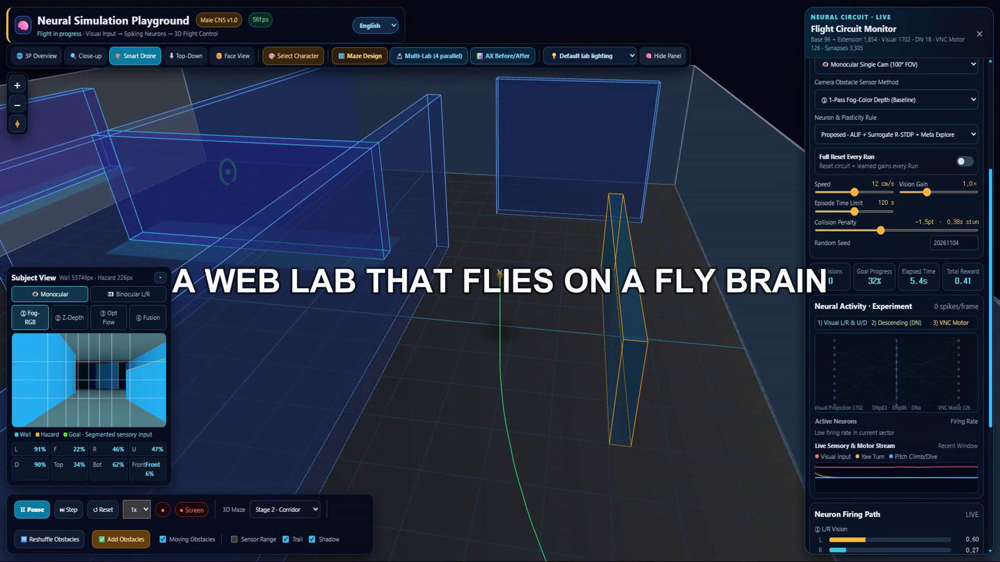
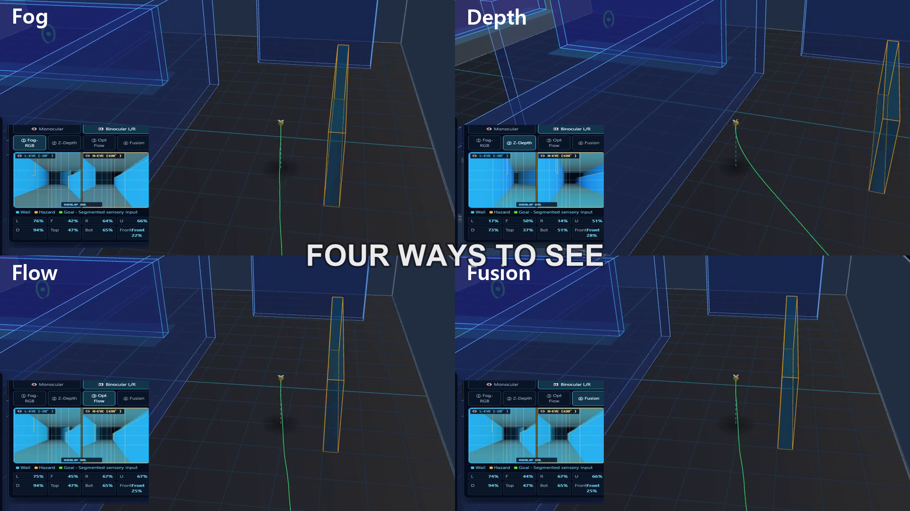
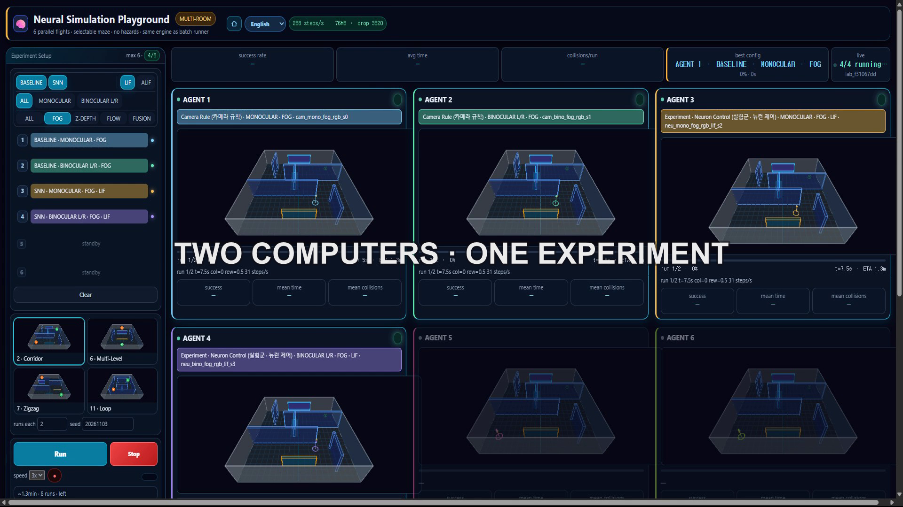

# NSP3D — Neural Simulation Playground 3D

[English](README.md) | 한국어

**초파리 신경회로를 이용한 3D 비행 시뮬레이션 플레이그라운드**

카메라가 본 환경을 뉴런에 전달하고, 뉴런의 반응으로 비행 방향을 제어합니다.

**Meta Global AI Developer Hackathon 2026 프로젝트**

<p align="left">
  
  
  
  
  
  
  
</p>

## 데모

**▶ 3분 영상 보기**

[](https://youtu.be/jirq_4vpjL0)

**🚀 브라우저에서 바로 실행**

<p align="left">
  <a href="https://jiyoung-ai-lab.github.io/nsp3d-hackathon/"></a>
</p>

설치 없이 직접 날려보세요.

## 프로젝트 소개

가상 3D 환경에서 시각 정보가 신경회로를 거쳐 비행 행동으로 이어지는 과정을 탐구합니다.

카메라 → 뉴런 → 행동

NSP3D는 초파리의 신경 연결 데이터(Male CNS v1.0)를 활용해 3D 가상 환경에서 비행 제어를 실험하는 브라우저 기반 시뮬레이터입니다. Three.js를 이용해 3D 환경을 구현하고, 카메라 입력에서 신경회로의 반응과 행동 제어까지 이어지는 과정을 하나의 흐름으로 연결합니다.

사용자는 3D 미로에서 비행실험체가 장애물을 인식하고, 신경회로를 통해 방향을 결정하는 과정을 관찰할 수 있습니다.

* **신경회로:** 1,854개 뉴런과 3,305개 방향성 연결로 구성된 Male CNS 기반 부분 커넥톰 그래프
* **비행 환경:** 1m × 1m × 0.20m 챔버와 10종의 미로 레이아웃
* **시각 입력:** 단안·양안 카메라와 Fog, Depth, Optical Flow, Sensor Fusion
* **신경 모델:** 기본 LIF, 선택형 ALIF 대리 모델
* **실험:** 브라우저 기반 배치 실행과 결과 비교

일반적인 딥러닝 모델처럼 모든 뉴런이 항상 활성화되는 구조는 아닙니다. ALIF 비행에서 발화 임계값을 넘는 뉴런은 약 2~3%입니다. 이 수치는 2026년 11월 1일 AX 본테스트 기준입니다.

## 핵심 질문과 현재 결과

### 1. 브라우저에서 가상 실험실을 만들 수 있을까?

가능합니다.

브라우저에서 시뮬레이션과 배치 실험을 실행하고, 누적 1,500회 이상의 비행을 테스트했습니다. 노트북과 PC 간 동일 조건의 결과도 비교했습니다.

별도의 LIF·ALIF 본테스트에서는 총 864회의 비행을 수행했습니다. 이 결과는 누적 실험 횟수와 구분하여 해석해야 합니다.

### 2. 뉴런 제어기가 더 잘 날까?

환경과 조건에 따라 다릅니다.

어려운 복도형·지그재그 미로에서는 뉴런 제어기가 카메라 규칙 기반 제어보다 유리한 결과를 보였습니다. 반면 쉬운 미로에서는 카메라 제어기도 98%의 성공률을 기록했습니다.

LIF·ALIF 본테스트 864회에서는 다음과 같은 결과가 관찰되었습니다.

| 모델   | 실험 횟수 |   성공률 | 평균 충돌 횟수 | 평균 소요 시간 |
| ---- | ----: | ----: | -------: | -------: |
| ALIF |   432 | 91.9% |    1.66회 |    29.4초 |
| LIF  |   432 | 86.1% |    2.03회 |    33.9초 |

해당 테스트 조건에서는 ALIF가 LIF보다 성공률이 5.8%p 높고, 평균 충돌 횟수와 소요 시간이 낮게 관찰되었습니다. 다만 이 결과가 모든 환경에서 동일하게 나타난다는 의미는 아닙니다.

현재 결과는 기술통계이며, 통계적 유의성 검정은 수행하지 않았습니다.

### 3. 뉴런이 스스로 학습할 수 있을까?

아직 구현 및 검증 단계입니다.

3-Factor R-STDP 학습 경로는 연결되어 있지만, 현재 보고된 배치 실험은 모두 학습을 끈 상태입니다. 따라서 실험 결과는 학습 효과를 보여주지 않습니다.

## 모델과 생물학적 범위

**신경회로 데이터는 초파리(Male CNS v1.0)를 기반으로 합니다.**

* 커넥톰: Male CNS v1.0의 해부학적 연결 데이터를 기반으로 선별·구성한 부분 커넥톰
* 뉴런 모델: LIF 및 선택형 ALIF 대리 모델
* 시각 처리: 초파리의 시각 구조를 참고한 가상 양안 카메라
* 행동 제어: 관련 곤충 비행·회피 연구를 참고한 시뮬레이션 알고리즘

양안 시야는 정면 ±25° 범위의 중첩 처리 구간을 사용합니다. 광선 매핑에는 초파리 시각 구조를 참고한 기하학적 모델을 적용했습니다.

**주의:** 해부학적 연결 데이터가 실제 생물의 신경 반응이나 행동을 그대로 재현한다는 의미는 아닙니다. 시냅스 연결만으로 흥분·억제 관계를 확정하지 않으며, 본 프로젝트는 생물학적 반응을 검증하는 연구가 아닌 비행 제어 알고리즘 실험 플랫폼입니다.

3D 캐릭터 외형은 줄무늬가 있는 비행실험체 모델을 사용합니다. 캐릭터의 외형과 신경회로의 생물학적 출처는 구분합니다.

## 기술 구성

| 구성    | 내용                                      |
| ----- | --------------------------------------- |
| 3D 엔진 | Three.js r160                           |
| 시뮬레이션 | JavaScript 기반 비행·물리 엔진                  |
| 신경회로  | Male CNS v1.0 기반 부분 커넥톰 SNN             |
| 뉴런 모델 | LIF, 선택형 ALIF 대리 플러그인                   |
| 시각 입력 | Fog, Depth, Optical Flow, Sensor Fusion |
| 비행 제어 | 신경회로 기반 제어 및 카메라 규칙 기반 기준 제어            |
| 실험 분석 | Python 배치 하네스, 로컬 통계 분석                 |
| AI 활용 | Meta Muse Spark 및 Muse Code             |

### 시각 시스템

두 가지 카메라 구성을 지원합니다.

* 단안: 320 × 180, 수평 시야각 100°
* 양안: 216 × 160 × 2, 기준 간격 3.6mm, 외측 경사각 28°

시각 정보는 8 × 4 격자로 나누어 처리합니다. 장애물 점유율을 바탕으로 위협도를 계산하며, Fog·Depth·Optical Flow 정보를 개별적으로 처리하거나 결합할 수 있습니다.

시각 처리 과정에서는 RGB 기반 색상·영역 분류 경로와 센서 특징량 계산 경로를 구분합니다.

* **RGB 색상·영역 처리:** 화면의 색상 및 영역 정보를 분류하며, 바닥과 배경 영역을 구분하는 라우팅 등에 활용합니다.
* **센서 특징 처리:** Fog, Optical Flow, Depth 정보를 각각의 처리 경로에서 산출합니다.
* **Sensor Fusion:** 센서 특징량을 조합해 시각 입력으로 사용합니다. 깊이 정보의 신뢰도나 처리 안정성이 충분하지 않은 경우 조합 경로에서 제외할 수 있습니다.

최종 채택된 `fu13` 구성은 Fog와 Optical Flow 정보를 조합하고 Depth 정보를 제외한 Sensor Fusion 구성입니다.

RGB 색상 정보 자체가 거리나 움직임을 직접 측정하는 값은 아닙니다. 색상·영역 분류와 센서 특징량 계산은 서로 다른 역할을 수행합니다.

기준 위협도 계산식:

`threat = (occ - 0.025) * 1.5`

센서별 처리 방식과 실험 설정은 `docs/CHANGELOG.md` 및 `docs/NSP_3D_MERGED_SPEC_v2.md`를 참고하세요.

### 비행 제어기

| 제어기    | 특징                    | 학습 상태         |
| ------ | --------------------- | ------------- |
| LIF    | 커스텀 스파이킹 신경망, 차동 리드아웃 | 배치 실험은 학습 OFF |
| ALIF   | LIF에 적응형 발화 임계값 적용    | 배치 실험은 학습 OFF |
| Camera | 카메라 신호 기반 규칙 제어       | 학습 없음         |

R-STDP는 향후 학습 실험을 위한 경로이며, 현재 보고된 성능 결과에는 반영되지 않았습니다.

LIF와 ALIF는 지속적인 시각 자극에 대한 발화 반응에서도 차이가 관찰됩니다. LIF는 지속적인 자극에서 발화가 누적되거나 좌우 발화 반응이 포화될 가능성이 있으며, ALIF는 적응형 발화 임계값을 통해 지속적인 자극에 대한 반응을 조절합니다.

이러한 차이는 두 모델의 동작 특성을 설명하기 위한 기술적 해석입니다. 뉴런의 포화나 좌우 발화율 차이의 소실이 성능 차이의 직접적인 원인인지는 별도의 뉴런별 발화 기록과 분석으로 추가 확인해야 합니다. 이를 입증된 생물학적 메커니즘으로 단정하지 않습니다.

동일 입력 조건에서 측정한 발화율입니다 (1,854 뉴런, 120스텝 평균).

| 모델 | 약한 자극 | 편측 위협 | 양측 위협 |
| ---- | ----: | ----: | ----: |
| LIF | 9.5% | 18.3% | 36.5% |
| ALIF | 0% | 5.2% | 10.4% |

ALIF는 동일 입력에서 LIF의 약 28%만 발화합니다. 약한 지속 자극에서는 ALIF가 침묵을 유지한 반면 LIF는 9.5% 발화했습니다. 고정 입력 프로브 기준이며, 실비행 수치는 조건에 따라 달라집니다.

## 실험 환경

실험은 브라우저에서 실행되며, 로컬 배치 하네스를 통해 여러 설정과 시드를 반복 테스트할 수 있습니다.

| 도구                        | 기능                       |
| ------------------------- | ------------------------ |
| `pages/experiment.html`   | 최대 4개 슬롯의 수동 비교 실험       |
| `pages/batch.html`        | 23개 그룹 배치 실험             |
| `pages/multilab.html`     | 최대 6개 실험을 병렬로 실행하는 공개용 랩 |
| `pages/path-planner.html` | A* 경로 탐색 테스트             |
| `pages/maze-editor.html`  | 미로 편집                    |
| `pages/vision-lab.html`   | 시각 입력 테스트                |

실험 설정은 `experiments/configs.json`에 관리합니다. 결과는 로컬 IndexedDB 또는 파일로 저장할 수 있습니다.

### 실행 성능

* Headless SwiftShader: 약 90~140 FPS (12초 테스트)
* GPU 시각 캡처: 약 25~60 FPS (8프레임 기준)
* 배치 실행: 최대 4개 슬롯 동시 실행
* 실험 조건: 동일 설정과 시드로 1~200회 반복 가능

실행 성능은 브라우저, 하드웨어 및 실험 조건에 따라 달라집니다.

### 테스트

```bash
npm test

# 카메라 파이프라인 검증
node tests/verify-camera-pipeline.mjs

# 비행 신경회로 검증
node tests/verify-flight-circuit.mjs

# 브라우저 회귀 테스트 (머신당 1회 설정 + 루트 서빙)
npm install
npx -y playwright@1.64.1 install --only-shell chromium
node tests/serve.mjs --port 8000  # 별도 터미널, 리포 루트 서빙
NSP_PAGE=http://127.0.0.1:8000/index.html node tests/verify.browser.mjs
```

현재 단위 테스트 결과: 176 PASS, 0 FAIL, 9 SKIPPED.

## 실험 결과와 한계

현재 확인된 한계도 공개합니다.

* **공간 기억 부족:** 현재 제어기는 반응형 구조입니다. S자 미로나 목표가 가려지는 환경에서는 대부분 실패합니다.
* **양안 시야 편향:** 양안 구성에서 정면 위협도가 단안보다 높게 측정되는 경향이 있습니다.
* **학습 미검증:** 보고된 모든 배치 실험은 학습 OFF 상태입니다.
* **뉴런 활성 희소성:** ALIF 순항 비행에서 발화 임계값을 넘는 뉴런은 약 2~3%입니다.
* **비행 실험 범위:** 총 9종의 미로에서 비행 테스트를 수행했습니다. AX 적용 전후 비교는 이 중 이전 테스트와 겹치는 3종(미로 2·6·7)의 미로에서 진행했습니다.
* **환경 검증 범위:** 실험 환경과 미로 유형이 제한적이며, 다양한 환경 변화에 따른 체계적인 비교 분석은 개발 기간의 제약으로 충분히 수행하지 못했습니다. 다른 미로 구조와 장애물 배치, 환경 조건에 대한 추가 검증이 필요합니다.
* **변경분 재검토:** 현재 결과는 고정된 실험실 구성에서만 유효합니다. 챔버 크기·실험체 크기·해상도·파라미터 등 환경이 바뀌면 기존 결과를 그대로 적용할 수 없으며, 바뀐 부분은 별도 검토와 재실험이 필요합니다.
* **Depth A/B 비교:** 미로 2·6·11의 단안·양안 조건으로 구성된 6개 실험 셀에서 Depth 포함 구성과 제외 구성을 동일 조건·동일 시드로 비교했습니다. 종합 비교 결과 Depth 제외 구성이 4개 셀에서 우세했고, 2개 셀에서는 열세였습니다. 특히 미로 2 양안 조건에서는 Depth 포함 구성이 성공률과 충돌 횟수 측면에서 더 나은 결과를 보였습니다. 따라서 Depth 제외가 모든 환경에서 더 우수하다고 일반화할 수 없습니다.
* **통계적 한계:** 성공률은 반복 실험에서 얻은 기술통계이며, 통계적 유의성 검정은 수행하지 않았습니다.
* **표본 수:** 예를 들어 12회 중 12회 성공은 해당 조건의 결과이지, 100% 성공을 보장하지 않습니다.
* **워커 간 비교:** m16 실험은 센서 조건과 실행 머신이 교락되어 있어 센서 성능 비교 근거로 사용하지 않습니다.
* **뉴런 발화 해석:** LIF의 발화 포화와 ALIF의 적응 반응은 관찰된 모델 동작을 설명하는 가설적 해석입니다. 성능 차이의 직접적인 원인으로 확정하려면 뉴런별 발화 기록과 추가 분석이 필요합니다.

## 소스 구조

```text
nsp3d-hackathon/
├── index.html
├── src/
│   ├── config.js
│   ├── lab/
│   ├── nn/
│   ├── sim/
│   ├── store/
│   ├── ui/
│   └── vision/
├── vendor/connectome/
├── pages/
├── experiments/
├── tests/
├── docs/
├── assets/
├── python/
├── package.json
└── README.md
```

주요 모듈:

| 파일                             | 역할                |
| ------------------------------ | ----------------- |
| `src/vision/camera-vision.js`  | 카메라 입력 및 시각 정보 처리 |
| `src/nn/graph-network.js`      | 커넥톰 기반 스파이킹 신경회로  |
| `src/sim/sim-core.js`          | 3D 환경과 비행 물리      |
| `src/sim/camera-controller.js` | 규칙 기반 기준 제어기      |
| `src/sim/maze-layouts.js`      | 미로 지오메트리          |
| `src/ui/app.js`                | 메인 UI 및 시뮬레이션 실행  |

## 실행 방법

Python이 설치되어 있다면 별도 빌드 과정 없이 실행할 수 있습니다.

```bash
cd nsp3d-hackathon
python -m http.server 8000
```

브라우저에서 다음 주소를 엽니다.

`http://localhost:8000/index.html`

## 개발 및 AI 도구 활용

* **Meta Muse Spark:** 자연어 기반 분석 및 개발 지원
* **Muse Code:** 코드 작성 및 개발 보조
* **Baseten:** Muse Spark Open 모델 활용 및 API 실험

AI 도구의 사용 내역과 프로젝트 내 역할은 다음 문서에 기록했습니다.

* `docs/META_AI_USAGE.md` — Baseten API 58콜의 호출 기록·용도별 집계
* `docs/MUSE_SPARK_USAGE.md` — AI 산출물 목록과 개발 과정 기록
* `docs/MUSE_CLI_USAGE.md` — CLI 세션 활용 내역과 사용량 근거

실험 하네스와 분석 도구는 로컬 개발용이며, 공개 시뮬레이터와 구분됩니다.

## Meta 기술 활용

해커톤 기간 중 사용한 Meta 기술과 사용량입니다.

| 모델 | 채널 | 용도 | 사용량 |
| ---- | ---- | ---- | ---- |
| muse-spark-1.3-contributor | Muse Code CLI | 코드 생성·디버그·문서 | 2,758 세션 (전 프로젝트) |
| Meta AI | 챗 | 대회·촬영 문의 | 로그 없음 (간단 문의) |
| muse-spark-open-1026 | Baseten API | 자문·리뷰·로그 분석 | 58콜 · 262,708 토큰 |

* CLI(2026-10-27~11-02, 대시보드): In 2,009M · Out 12.2M · 요청 22.9k · 툴콜 128 · 캐시 적중 93.9%
* API(2026-10-29~11-02, credit_log 전수): In 79,351 · Out 183,357 — 자문·리뷰 33건, 계획·문서 18건, 내러티브 1건, 프로브 6건
* 흐름: Meta AI → VSCode 터미널 → Muse CLI → Baseten API·코딩·AX 배치(로컬 CPU, API 토큰 0)·에이전트·Docker·AI 챗
* 근거: `docs/META_AI_USAGE.md`, `docs/MUSE_SPARK_USAGE.md`, `docs/MUSE_CLI_USAGE.md`, `python/credit_log.jsonl`

## 관련 문서

* `docs/PROJECT_STORY.md` — 제출 설명서 원본. 추진 배경과 현재 결과 요약
* `docs/PRE_HACKATHON_SOURCE_REVIEW.md` — 기존 작업과 해커톤 신규 기여 구분. 규정 준수 문서

## 출처와 라이선스

커넥톰 데이터는 Janelia Research Campus의 Male CNS v1.0 자료를 사용합니다.

* 데이터 라이선스: CC BY 4.0
* 데이터 출처와 처리 내역: `docs/CITATIONS.md`
* 외부 라이브러리 및 자산: `docs/THIRD_PARTY_NOTICES.md`

기존 자체 개발 자산과 외부 자료를 구분해 기록하고 있습니다.

데모 영상에 사용된 음악과 커넥톰 시각 자료의 출처는 관련 문서와 영상 크레딧에 표시합니다.

## 특허

2026년 11월 기준, 한국 특허 **출원 준비 단계**입니다.

대상 기술은 양안 시각 정보 처리와 Male CNS 기반 부분 커넥톰 신경회로를 이용한 3D 비행 제어 방법입니다.

프로젝트 소스의 공개 및 열람은 특허 실시권을 의미하지 않습니다.

## 라이선스

현재 별도 오픈소스 라이선스를 부여하지 않았습니다.

라이선스가 확정되기 전까지 All rights reserved로 관리합니다.

Meta Global AI Developer Hackathon 2026 참가와 관련하여, 작성자는 공식 규정에 명시된 권리를 주최측에 부여합니다(행사 운영 및 홍보를 위한 사용·게시·수정의 royalty-free 라이선스).

## 스크린샷

<p align="center">
  
  
  
</p>
