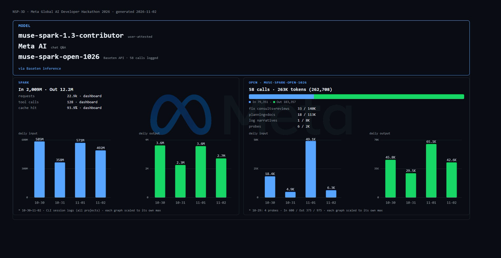
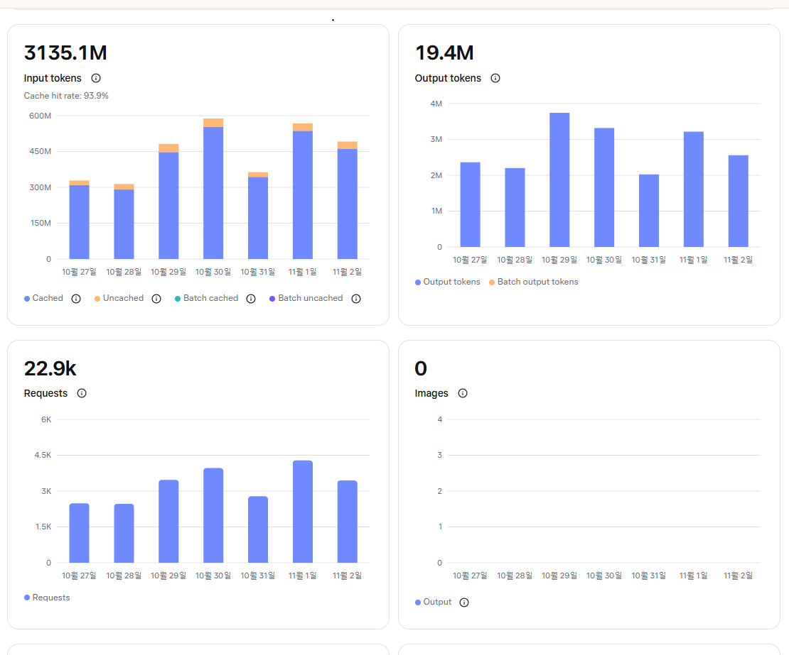

# Meta AI Usage (Hackathon)

Model: `meta-models/muse-spark-open-1026` ONLY, via Baseten inference
(`https://inference.baseten.co/v1`, OpenAI-compatible chat completions).
No other model is called by code in this repo (CLI/chat models are developer-side; see `MUSE_CLI_USAGE.md`).
(`ax-platform` is local Bayesian optimization, not an API model.)

## What it is used for

1. Experiment-log narratives — `python/analyze.py --llm`
   Sends locally computed stats JSON only (never raw logs).
   1 call per analysis → verdict + correlations + failure causes + 1 tuning tip.
   Token-gated (`--token-limit`, default 5M); every call appended to
   `python/credit_log.jsonl` (local-only, git-ignored).
2. Connection probe — `python/ba/probe_api.py`
   Key check + rate-limit header read. Same credit logging.
3. Coding assistant — Muse Code (agentic CLI) for the K-fix development
   documented in `docs/CHANGELOG.md`.
4. Fix consults — `python/ba/query_fix.py PROMPT --out ANSWER`
   One-shot engineering questions, usually with short code excerpts.
   Whole-file sends are the exception and are noted per record (v5 review).
   Same credit logging. Answers are advisory; applied only after human review.
   Lesson 2026-10-30: the model is reasoning-heavy — `max_tokens=2000`
   truncates with empty content; use 6000 for fix consults.
5. Ax study loop — `python/ax_loop.py` (`ax-platform` 1.3.1, local CPU).
   Multi-objective (success↑ collisions↓) over configs; browser trials via
   `python/trial.cjs`. No model calls, no tokens. First study `multi0`
   (exp_multi, 12 trials) finished 2026-10-31 with 0 failures.
6. Meta AI chat — competition questions, video-shooting how-to, other quick
   questions (user-attested 2026-11-02, no logs).

## Local-only compute (0 API tokens)

- SNN is custom JavaScript (`src/nn/graph-network.js`).
- `ax-platform` + `torch` CPU in `requirements.txt` (2026-10-31) power the
  local Ax study loop — 0 API tokens, not model calls.

## Session cache-upload confirm (2026-11-01)

- CONFIRMED: at CLI session start, project files are cache-uploaded to
  the Meta connection for context. Exclusions are enforced by filter,
  not by convention.
- Filter: `.codeignore` (local dev loop only; submission packaging
  is separate). Listed paths stay on this machine and are NOT uploaded:
  `experiments/`, `results/`, `*.log`, `credit_log.jsonl`,
  `flight_log_*.jsonl`, `results_*`, `capture/`, `node_modules/`,
  `docs/`, `python/`, `assets/`, `vendor/`, `.env`.

## CLI-main + BA one-shot complement (2026-11-01)

- Problem: the CLI holds one model per session. Opening a new session
  for a second model breaks coherence; switching models inside the
  current session drops the cache. Either way, context is lost.
- Solution in use: CLI stays the main worker (full session cache kept);
  `python/ba/query_fix.py` one-shot Baseten calls act as a second
  channel for consults and cross-reviews. Same model
  (`muse-spark-open-1026`), stateless prompts (brief + code excerpts),
  answers saved as `answer_*.md` + `.raw.json`, applied only after
  human review. Empty answers are recoverable from raw.json reasoning.
- Effect: a main-agent + reviewer workflow without new sessions or
  cache loss. Used for fix consults, cross-reviews (v5 patch, ALIF,
  sensor234, multilab lag), and citation/doc verification.
- Cost control: token-gated, credit-logged per call
  (`credit_log.jsonl`, git-ignored). Reasoning-heavy model, so
  `--max-tokens 6000` default for consults (8000 for long reviews)
  with a concise-reasoning prompt prefix.
- Model notes (2026-11-01): the open model held up well across coding,
  technical review, bottleneck/issue analysis, paper search, and
  data-validity checks. Reviews that caught real defects: right-avoidance
  slope (over-hot x1.5 corrected to x0.5 before landing), climb-veer
  latch (applied, then honestly reverted on flight-test regression),
  v5/ALIF/sensor234 cross-reviews, multilab lag bottleneck ranking.
  Advisory-only rule held throughout: applied only after human review
  and a green suite.

## Evidence (kept locally, NOT in this repo)

- `python/credit_log.jsonl` — per-call token usage + rate headers.
- `experiments/results/*` — batch logs/analysis (git-ignored by policy).
- `.env` holds `BASETEN_META_HACKATHON_API_KEY` (git-ignored; see `.env.example`).

## Muse Spark dashboard (video basis, separate from Open)

Source: Meta dashboard snapshots (originals kept in dev repo).
Matches the demo video subtitle `22.9K REQUESTS · 200M TOKENS`.

- Model: muse-spark-1.3-contributor (user-attested), Meta AI chat Q&A

### 4-day snapshot (10-30~11-02, `usage0.png`)

- Requests: 22.9K · tool calls: 128 · cache hit: 93.9%
- In 2,009M (cache included) / Out 12.2M

### 7-day snapshot (10-27~11-02, `meta_ai_usage_7day.png`)

- In 3,135.1M (93.9% cached) / Out 19.4M / 22.9k requests

- Video figure 200M tokens = cache-excluded basis: 3,135.1M x 6.1% = 191M in
  + 19.4M out = 211M ~= 200M (user-confirmed 2026-11-04)
- Scope: CLI session logs cover all projects; NSP_3D-only split impossible
  (see `MUSE_CLI_USAGE.md` §3)

## Call log (Open · Baseten API)

Source: `python/credit_log.jsonl` (per-call API `usage`, in/out split).
Dates are KST.

Daily totals (in / out / total):

| Date (KST) | Calls | Prompt | Completion | Total |
|---|---|---|---|---|
| 2026-10-29 | 4 | 600 | 375 | 975 |
| 2026-10-30 | 18 | 18,404 | 45,765 | 64,169 |
| 2026-10-31 | 6 | 4,872 | 29,531 | 34,403 |
| 2026-11-01 | 20 | 49,139 | 65,054 | 114,193 |
| 2026-11-02 | 10 | 6,336 | 42,632 | 48,968 |
| Total | 58 | 79,351 | 183,357 | 262,708 |

By purpose (58 calls, ≈263K tokens):

| Purpose | Calls | Tokens |
|---|---|---|
| fix consults + cross-reviews | 33 | ≈140K |
| planning + docs | 18 | ≈113K |
| log narratives | 1 | ≈8K |
| connection probes | 6 | ≈2K |

Per-call list (model `muse-spark-open-1026` throughout).
Detail recorded through 2026-10-31. Daily totals above cover through
2026-11-02 per `credit_log.jsonl` (per-call task names live in that file).

| Date | Req | Task | Prompt | Completion | Total |
|---|---|---|---|---|---|
| 2026-10-29 | 4 | Connection probe x4 | 150x4 | 10+100+141+124 | 975 |
| 2026-10-30 | 1 | 7x10 batch narrative (149 fails) | 4,823 | 3,008 | 7,831 |
| 2026-10-30 | 3 | Right-avoidance fix consult x3 (2 truncated at 2k, 1 stop at 6k; see `python/ba/answer_right_avoidance{2,3}.md.raw.json`) | 1,077+595+595 | 2,000+2,000+4,135 | 10,402 |
| 2026-10-30 | 1 | Climb-veer fix consult (see `python/ba/answer_climb_veer.md.raw.json`) | 771 | 2,100 | 2,871 |
| 2026-10-30 | 1 | Export automation consult (truncated at 2k; see `python/ba/answer_export_automation.md.raw.json`) | 459 | 2,000 | 2,459 |
| 2026-10-30 | 1 | Direct-fetch follow-up: POST server + download fallback (see `python/ba/answer_export_direct.md.raw.json`) | 517 | 1,914 | 2,431 |
| 2026-10-30 | 1 | Dashboard redesign consult (see `python/ba/answer_dashboard_redesign.md.raw.json`) | 589 | 3,000 | 3,589 |
| 2026-10-30 | 1 | Sidebar UX consult turn1 (see `python/ba/answer_sidebar_ux.md.raw.json`) | 598 | 2,589 | 3,187 |
| 2026-10-30 | 1 | Preset picker UX turn2 (see `python/ba/answer_preset_picker.md.raw.json`) | 507 | 2,735 | 3,242 |
| 2026-10-30 | 2 | Traj replay+analysis consult + follow-up (see `python/ba/answer_traj_replay{,2}.md.raw.json`) | 798+363 | 2,500+1,584 | 5,245 |
| 2026-10-30 | 1 | Video production consult (see `python/ba/answer_video_ask.md.raw.json`) | 327 | 760 | 1,087 |
| 2026-10-30 | 1 | Connection probe | 150 | 210 | 360 |
| 2026-10-30 | 1 | Chrome-vs-Edge custom-maze diagnosis (see `python/ba/answer_chrome_custom_maze.md`) | 1,070 | 4,609 | 5,679 |
| 2026-10-30 | 3 | Flight-16case consult + retry + verdict (see `python/ba/answer_flight_16case*.raw.json`) | 1,747+1,841+1,577 | 4,000+4,000+2,621 | 15,786 |
| 2026-10-31 | 1 | Connection probe | 150 | 32 | 182 |
| 2026-10-31 | 1 | Storage managed-path design consult (see `python/ba/answer_storage_managed.md`) | 532 | 3,461 | 3,993 |
| 2026-10-31 | 1 | v5 external flight patch cross-review (see `python/ba/answer_v5_crossreview.md.raw.json`) | 1,222 | 7,727 | 8,949 |
| 2026-10-31 | 1 | ALIF engine-2 defect cross-review (see `python/ba/answer_alif_review.md`) | 1,086 | 6,506 | 7,592 |
| 2026-10-31 | 1 | Presentation master KR verification (see `python/ba/answer_pres_verify_kr.md`) | 1,014 | 6,483 | 7,497 |
| 2026-10-31 | 1 | Foreign citation verification (see `python/ba/answer_pres_verify_intl.md`) | 868 | 5,322 | 6,190 |

## Consult records

### 2026-10-30 — SNN frontal right-avoidance failure

- Question: why does neuron mode fail right-avoidance on frontal obstacles
  while rule mode passes? (`python/ba/query_right_avoidance_short.txt`)
- Answer gist (`python/ba/answer_right_avoidance3.md`): (1) `effEscapeEff` gate
  delays frontal drive; swap to `effEscape`. (2) `boxedSNN` x0.45 suppression
  backfires under refractory saturation; delete block, lower frontal gain,
  add mutual inhibition. (3) `turnSign` 0.006 deadzone quantizes away fine
  differentials; switch to continuous `clip(turnIntent*1.5)`.
- Status: cause 3 applied as K29 trial (flag `SNN_CONTINUOUS_TURN`, revert
  to V1.6 path in one line); causes 1-2 NOT applied. Verification catch:
  Baseten's x1.5 slope was 3x hotter than the V1.6 effective slope (x0.5)
  and broke 5 straight-flight contract tests — corrected to deadzone .001
  + slope x0.5 before landing. Suite: 160 pass + 6 skip, 0 fail.

### 2026-10-30 — climb veers lateral in dive->climb transition (bino, both controllers)

- Question: why does the climb veer L/R instead of straight up when a
  frontal obstacle appears during descent? (`python/ba/query_climb_veer.txt`)
- Answer gist (`python/ba/answer_climb_veer.md`): confirmed the gap hypothesis —
  `verticalPassage=false` between bottom-gate release and top-gate latch
  restores full lateral authority. Fix: 250ms `verticalPassageHold` latch
  bridging the gap + harden suppression to .02 + zero turn during hold,
  in both controllers with parity.
- Status: SNN side solved neurally as K30 (flag `SNN_CLIMB_INHIBIT`;
  climb-commitment hyperpolarizes lateral pools, gain 1.2); rule side got
  the proposed latch as K31 (flag `RULE_VERT_HOLD`, 250ms, suppression
  .08→.02, cast gate extended), and SNN got the same latch as K31
  (flag `SNN_VERT_HOLD`, .06→.02, saccade gate extended) for parity.
  Turn-zeroing staged out (K30 covers SNN; goal/touch survive in rule).
  Suite: 163 pass + 6 skip, 0 fail (K31 hold tests included).
  REVERTED same day: flight test worse with K30+K31 on. All three flags
  off (`SNN_CLIMB_INHIBIT`, `SNN_VERT_HOLD`, `RULE_VERT_HOLD`); K29 stays.
  Suite: 160 pass + 9 skip, 0 fail. Cause TBD (over-suppression suspected).

### 2026-10-30 — direct export from IndexedDB to project folder

- Question: most reliable way to move session data (IndexedDB) into the
  project folder after File System Access API (permission errors) and a
  download-folder watcher (file-lock crashes) both failed?
  (`python/ba/query_export_direct.txt`)
- Answer gist (`python/ba/answer_export_direct.md`): tiny localhost POST
  server + download fallback. Page POSTs files; server writes atomically
  (.tmp + os.replace); CORS preflight handled; multi-MB needs no chunking.
  No better option under static-page constraints.
- Status: implemented as `python/save_server.py` (local-only, git-ignored)
  + `saveFile()` POST-first path in `pages/multilab.html` with download
  fallback. Verified: POST probe returns 200 and lands byte-identical.
  Public page stays standalone.

### 2026-10-30 — Multi-Lab page UX dialogue (3 turns)

- Questions: analysis-dashboard layout, sidebar organization, preset
  picker for the 2×2×4 combo space (dashboard → sidebar turn1 →
  preset turn2; answers under `python/ba/answer_*.md`).
- Answer gist: KPI strip, left filter sidebar, filter-driven max-4
  picker, maze thumbnails, agent color slots.
- Status: applied to `pages/multilab.html` (KO/EN) after human review;
  colors/terms re-aligned to `index.html` tokens, confirm gate later
  removed (auto-sync). Tokens: 3,589 + 3,187 + 3,242.

### 2026-10-30 — Chrome missing custom-maze menu (Edge shows it)

- Question: why does `<select id="scenario">` show customs in Edge but
  not Chrome, plus slight Edge/Chrome rendering differences?
  (`python/ba/query_chrome_custom_maze.txt`)
- Answer gist (`python/ba/answer_chrome_custom_maze.md`): (1) per-browser
  localStorage isolation is the expected cause (90%, not a Chrome bug).
  (2) Five masked causes ranked: profile/Incognito, corrupt JSON,
  blocked site data, file:// vs http://, extensions. (3) Code hardening
  sketches: per-key safeParse + warning banner + JSON export/import.
  (4) Cosmetic suspects: zoom/DPR/fonts, native controls/color-scheme,
  GPU/AA.
- Verification: catch-all `return []` confirmed in
  `src/sim/maze-layouts.js` L354; one bad key kills the bridge read
  (outer catch skips it) — real find. Fix sketches reference real
  functions; `saveCustomMaze` reuse in the import loop is valid.
- Status: diagnosed, NOT applied. Awaiting human review.

### 2026-10-31 — managed storage path for recordings/logs

- Question: permission-safe, NSP-managed download path alternative
  (`python/ba/queries/query_storage_managed.txt`).
- Answer gist (`python/ba/answer_storage_managed.md`): OPFS + IndexedDB
  managed store with download fallback (dual-write until the report page lands).
- Status: applied as `src/store/nsp-store.js` + `src/ui/rec-filename.js`,
  wired into main sim + multilab slot/tab recording. Verified by
  `tests/verify-store.mjs` + `tests/verify-rec.mjs`.

### 2026-10-31 — v5 external flight patch cross-review

- Question: review the external v5 flight patch (3 files, paper-backed:
  Kemppainen/Serres/VFH/Beyeler) for selective apply
  (`python/ba/queries/query_v5_crossreview.txt`, whole files sent).
- Answer gist (`python/ba/answer_v5_crossreview.md`): selective apply —
  Tier0 immediate (rayAngle + cScale), Tier1 retuned (.17 floor too tight),
  V1/V6/C5 excluded, m5 complex flagged malicious.
- Status: Tier0 locked (11→20/42), Tier1 neutral, then user overrode to
  full-apply + full-rollback fallback. Full apply locked: 37/42 + 11/18
  Citations #54–#57 landed.

### 2026-10-31 — ALIF engine-2 defect cross-review

- Question: verify 3 external defect claims (dead adapt, missing /0.85,
  learning flag) + fix direction + test plan
  (`python/ba/queries/query_alif_review.txt`, excerpts only).
- Answer gist (`python/ba/answer_alif_review.md`): claim 1 MUST-FIX
  (mechanism exact; immediate-reset-at-spike recommended over flag
  preservation, adapt must decay thru refractory), claim 2 SHOULD-FIX
  (/0.85 AND clamp 0.75→0.85), claim 3 SHOULD-FIX (enable flag only
  for the learning probe). Full ALIF matrix re-run required.
- Status: claims 1+2 fixed in `src/vision/alif-surrogate-plugin.js`,
  `tests/verify-alif-adapt.mjs` added (failed pre-fix, PASS post-fix),
  30-run ALIF re-measure done (LIF 9/9 identical, ALIF 14/21 succ).
  Learning flag stays false until the learning phase.

### 2026-10-31 — presentation master KR verification

- Question: cross-check 5 disputes from my code-vs-doc audit
  (L/R splits, transmitter counts, sparsity mean, 2 cross-doc cells,
  ALIF evidence chain) + jury-Q&A risk
  (`python/ba/queries/query_pres_verify_kr.txt`, findings only, no browsing).
- Answer gist (`python/ba/answer_pres_verify_kr.md`): all 5 confirmed
  (stale-table pattern, arithmetic slip, cherry-pick signal on 2 cells,
  orphaned ALIF results). Verdict: MUST-FIX-FIRST. Most dangerous: D5
  (ALIF numbers), then D4 (2 favorable cells). Re-measure plan included.
- Status: recorded. D1–D3 and D6 fixed; D4–D5 held for batch re-measure.

### 2026-10-31 — foreign citation verification

- Question: cross-check 15-paper API audit (4 wrong IDs, 1 unverified,
  hygiene) + fix priority
  (`python/ba/queries/query_pres_verify_intl.txt`, findings only).
- Answer gist (`python/ba/answer_pres_verify_intl.md`): F1–F4 are
  fabrication-level (wrong paper cited), not sloppy links. Most
  embarrassing: F2 (same paper under two names). Fix: delete/replace
  per item, DOI-only where no PMC exists, same fixes to our
  CITATIONS.md #27/#55/#56. Bender DOI candidates supplied (both
  failed my Crossref re-check — still unverified).
- Status: applied 2026-10-31 to `docs/CITATIONS.md` (#25/#27/#55/#56)
  and presentation §9. Zero bad IDs remain (re-checked). Bender #18
  deleted outright per user decision (tombstone kept, no renumber).
